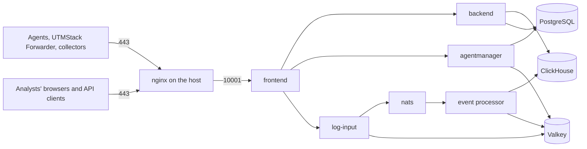

UTMStack v12 runs on a single Linux server as a set of Docker containers, with a web server (nginx) on the host in front of them. This page explains the services, how traffic reaches them, how logs flow from a source to an alert, and where data is stored.

## Deployment model

The installer sets up **one server**. It installs Docker, starts Docker Swarm (Docker's built-in mode for running containers as managed services) on that server and deploys all UTMStack services there as one stack named `utmstack`. The installer has no option to add or join more servers.

To serve several customers or departments from one server, use **tenants**. Tenants need a licence with the multi-tenant option. Each tenant has its own users, settings, alerts, integrations, response flows and audit data. See **License and Editions**.

<Note>

UTMStack v11 described manager and worker nodes, multi-node clusters and Elasticsearch clusters. None of these apply to UTMStack v12.

</Note>

## How it fits together

- **nginx on the host** listens on ports 80 and 443. Port 80 only redirects to HTTPS. Port 443 carries everything: the web interface, the API, agent connections and agent downloads. nginx forwards all of it to the frontend container on `127.0.0.1:10001`.
- **The frontend container** serves the web interface and routes each request to the right service inside the server.
- **All other services** are reachable only inside the server's Docker network. They do not publish ports on the host.

## Services

| Service | Image | What it does |
|---|---|---|
| `frontend` | `ghcr.io/utmstack/utmstack/frontend` | Serves the web interface and routes API, agent and download traffic. Published on the host as port 10001. |
| `backend` | `ghcr.io/utmstack/utmstack/backend` | The REST API under `/api/v1`. API documentation is served at `/swagger`. |
| `agentmanager` | `ghcr.io/utmstack/utmstack/agent-manager` | Registers agents and collectors, sends them commands and serves their installers and updates. |
| `log-input` | `ghcr.io/utmstack/utmstack/log-input` | Receives logs from agents, the UTMStack Forwarder and collectors, and puts them on the queue. |
| `nats` | `nats:2.10-alpine` | The queue between log intake and processing. It keeps messages on disk, so a restart of either side does not lose them. |
| `event-processor-worker` | `ghcr.io/utmstack/utmstack/eventprocessor` | Parses, enriches and correlates logs. |
| `event-processor-manager` | `ghcr.io/utmstack/utmstack/eventprocessor` | Manages the event processor and serves the SOC-AI service and the pipeline and rule test playground to the backend. |
| `clickhouse` | `clickhouse/clickhouse-server:25.8` | Stores logs, alerts and statistics. ClickHouse is a database built for large volumes of log data. |
| `postgres` | `ghcr.io/utmstack/utmstack/postgres` | Stores configuration: users, tenants, settings, incidents and more. |
| `valkey` | `valkey/valkey:9-alpine` | A short-lived cache of agent and collector credentials, used by `agentmanager` and `log-input`, and of recent alerts for de-duplication, used by the event processor. |

The UTMStack images use the tag of the installed version, for example `v12.0.2`. In Docker the services are named with the stack prefix, for example `utmstack_backend`. Ports, folders and logs of each service are listed in **Server Services and Files Reference**.

## How requests are routed

| Path on port 443 | Goes to |
|---|---|
| `/` (web pages) | The web interface in `frontend` |
| `/api` | `backend` |
| `/api/ping` | The backend health check (`/api/v1/health`) |
| `/swagger` | The backend API documentation |
| `/private/dependencies` | `agentmanager` (agent and collector downloads) |
| `/agent.AgentService/`, `/agent.PanelService/`, `/agent.CollectorService/`, `/agent.PingService/` | `agentmanager` (agent connections, over gRPC) |
| `/plugins.Integration/` | `log-input` (log streams, over gRPC) |

gRPC is the protocol agents and collectors use to talk to the server. It runs inside the same HTTPS connection on port 443.

The host nginx adds a shared secret to every request it forwards. The frontend container refuses API requests that do not carry it.

## How a log becomes an alert

1. An agent, the UTMStack Forwarder, a collector or a cloud integration produces a log.
2. Agents, the Forwarder and collectors send the log to the server on port 443. Cloud integrations (for example AWS, Microsoft 365 or Google Cloud) are pulled by the server itself.
3. `log-input` receives the log and puts it on the `nats` queue. It confirms receipt to the agent only after the queue has stored the log on disk. The queue keeps a log until the event processor takes it, for at most 24 hours.
4. The event processor takes the log from the queue and parses it with the pipelines for its data type (**Configure > Pipelines**). It then runs the parsed log through its plugins:
   - **Analysis**: stores the parsed log in ClickHouse and applies threat intelligence feeds and Active Directory auditing.
   - **Correlation**: runs the correlation rules, which raise alerts, then SOC-AI analysis and automated response flows (SOAR).
   - **Notification**: records ingestion statistics.
5. Alerts and statistics are written to ClickHouse as well.
6. The backend reads logs and alerts from ClickHouse and shows them in Log Explorer, Alerts, dashboards and the other pages.

## Where data is stored

| Data | Where | On the host |
|---|---|---|
| Logs, alerts, ingestion statistics | ClickHouse tables `utmstack.logs`, `utmstack.alerts` and `utmstack.statistics`, split by month | `/utmstack/clickhouse/data` |
| Logs and alerts moved to cold storage | The cold storage you configure: an S3-compatible bucket, Azure Blob Storage, or a local or NFS folder | `/utmstack/clickhouse/cold` for a local or NFS folder |
| Users, tenants, settings, incidents, agent registrations and other configuration | PostgreSQL databases `utmstack` and `agentmanager` | Docker volume `utmstack_postgres_data`, under `/var/lib/docker/volumes` |
| Rules, pipelines, response flows, compliance files | Event processor work folder | `/utmstack/events-engine-workdir` |
| Uploaded images (avatars, branding) | Backend uploads folder | `/utmstack/uploads` |
| Queue messages not yet processed | NATS | `/utmstack/nats` |
| Certificates | Files used by nginx and internal services | `/utmstack/cert` |
| Licence, instance ID, version, memory limits | Update service files | `/utmstack/updates` |

How long data is kept is set in **Configure > Settings > Data Retention**. See **Data Retention and Cold Storage**. UTMStack has no built-in backup feature; see **Backups and Recovery**.

## Security design

- **Encryption in transit.** nginx on port 443 accepts TLS 1.2 and TLS 1.3. TLS 1.2 is kept so that Windows Server versions older than 2022 can connect. Agents and collectors use the same port and the same encryption.
- **Few open ports.** UTMStack listens on the host only through nginx (80 and 443) and the frontend container (10001). The installer also adds Cockpit (9090), a web console for server management. Port 10001 is for nginx on the same server only; block it from outside. See **Network Ports and Firewall**.
- **Container isolation.** Databases, the queue and internal services are reachable only inside the server's Docker network.
- **Access control.** Users have roles (Administrator, Analyst, Viewer, or roles you create) with fine-grained permissions. On a multi-tenant licence each tenant has its own users. See **Users** and **Roles and Permissions**.
- **Secrets.** The installer generates the database password and the internal keys at install time and stores them in `/root/utmstack.yml`, which only the root user should be able to read.

## Connections to UTMStack services

The update service on your server (`UTMStackComponentsUpdater`) talks to the UTMStack update server at `https://cm.utmstack.com`. It registers the server once and receives an instance ID, sends a heartbeat every minute, reports the number of events and bytes ingested per tenant every 15 minutes, sends the administrator's email address once it is set, and checks for updates and licence changes every 5 minutes. **Server Services and Files Reference** lists exactly what is sent.

The server also downloads installers from GitHub and container images from `ghcr.io` and Docker Hub. For the full list of outbound connections, see **Network Ports and Firewall**.
