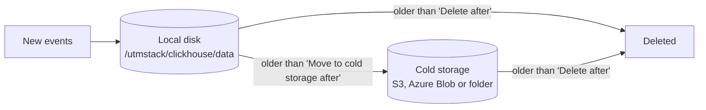

UTMStack v12 keeps logs, alerts and ingestion statistics in an event store built on ClickHouse, and everything else in a PostgreSQL database. This page explains where each kind of data lives, how retention and cold storage work, and what the disk badge on the **Data retention** page tells you.

## Two databases, two jobs

| Database | What it holds | Where it lives on the server |
|---|---|---|
| **ClickHouse** (the "event store") | Logs, alerts and ingestion statistics | `/utmstack/clickhouse/data` |
| **PostgreSQL** | Users, roles, tenants, settings, incidents, identity providers, API keys and other configuration | A Docker volume named `utmstack_postgres_data` |

ClickHouse is a database built for very large volumes of log data. It stores data by column and compresses it, which keeps searches fast and the disk footprint small.

Retention and cold storage apply only to the event store. Settings, users and incidents in PostgreSQL are not affected by anything on the **Data retention** page. For the other folders under `/utmstack`, see **Architecture**.

## The three datasets

The event store has one table per dataset. All tenants share the same three tables, which is why retention is one setting for the whole server rather than one per tenant.

| Dataset | Table | What it holds | Default "Delete after" |
|---|---|---|---|
| Logs | `utmstack.logs` | Every normalized event, with its original text | 730 days |
| Alerts | `utmstack.alerts` | Alerts raised by correlation rules, with their evidence and history | 730 days |
| Ingestion statistics | `utmstack.statistics` | How many events and bytes each source sent. This is the usage record of the server. | 1,095 days |

Alerts are kept as long as logs by default because an alert's evidence is the logs it points to. Statistics are small and are kept longer because they are the usage record.

## Monthly blocks

Each table is split into monthly blocks (ClickHouse calls them partitions), one block per calendar month of event time. Inside a month, records are sorted by tenant first, so a search for one tenant reads only that tenant's records.

The monthly blocks explain two things you will notice:

- **Data stays a little longer than you set.** The event store deletes whole blocks of data, not single records. A block is deleted only when every record in it is past the limit, so data can stay up to about one month longer than the number of days in **Delete after**.
- **Old data leaves in steps.** Disk space is freed when a block is dropped, not record by record.

## What retention does

**Delete after** is a time limit written into each table. When a record's event time is older than the limit, the event store deletes it in the background, wherever it is stored by then (on the local disk or in cold storage).

There is no recycle bin and no built-in backup. Records past the limit are gone for good.

## What cold storage does

Cold storage is a second, cheaper place for older records. When you set **Move to cold storage after** on a dataset, the event store moves records older than that many days from the local disk to the cold storage destination in the background.

Cold storage is not an archive:

- Records in cold storage stay searchable from the same pages as before: Log Explorer, alerts, dashboards and reports. Nothing has to be restored first.
- Searches that read cold records are slower than searches on the local disk, because the data comes over the network.
- Records are still deleted when they reach **Delete after**.

You can use one of these destinations:

| Destination | Best for | Guide |
|---|---|---|
| Amazon S3 | Servers in AWS, or any server with internet access | **Cold Storage with Amazon S3** |
| An S3-compatible store | MinIO, Ceph, Wasabi, Cloudflare R2, Google Cloud Storage | **Cold Storage with S3-Compatible Stores** |
| Azure Blob Storage | Servers in Azure, or organizations that use Azure | **Cold Storage with Azure Blob Storage** |
| Local folder or NFS | A second disk in the server, or a file share on your network | **Cold Storage on a Local Folder or NFS** |

### How cold storage is wired in

When you click **Enable cold storage**, UTMStack writes a small configuration file for the event store, `/utmstack/clickhouse/config.d/utmstack-tiering.xml`, and asks the event store to read it. The file declares the destination as a second disk and adds a storage policy named `hot_cold` with two volumes: `default` (the local disk) and `cold` (the destination).

For S3 and Azure, before UTMStack accepts the destination, the event store writes a small test file to it, reads it back and deletes it. If that fails, UTMStack removes the file again and shows the error, so a wrong bucket or key never stays configured. The test runs only when a destination is first added: **Update credentials** on a destination already in use is not tested again.

A dataset starts using the `hot_cold` policy the first time you save a **Move to cold storage after** value above 0 for it. From then on the dataset always uses the policy, which is why it cannot be switched back to local-only from the page.

For S3 and Azure destinations, the event store keeps the map of which stored object belongs to which part of a table on the server, under `/utmstack/clickhouse/data/disks/cold_disk/`.

<Warning>

Cold storage is not a backup. The objects in a bucket or container have generated names, and the map that ties them to your tables stays on the UTMStack server's own disk. If you lose the server's disk, the objects in the bucket cannot be read back into a new UTMStack server. Retention deletes records from cold storage as well. See **Backups and Recovery**.

</Warning>

Do not edit `utmstack-tiering.xml` by hand. UTMStack rewrites it every time you change cold storage on the page.

### When the local disk fills up

The `hot_cold` policy also protects the local disk. When less than 15% of the local disk is free, the event store starts moving parts of datasets that use cold storage to the cold destination early, largest parts first, until 15% is free again. This only applies to datasets that already use cold storage.

UTMStack v12 does not delete data early when the disk fills up. If the disk runs full, the event store cannot store new events. Watch the disk badge and plan ahead. See **Planning Retention and Disk Space**.

## The disk badge

At the top right of **Configure > Settings > Data Retention**, a badge shows **Disk N% used**: how full the event store's disks are.

| Badge | Meaning |
|---|---|
| Grey | The disk is 90% full or less. |
| Amber | The disk is more than 90% full, or the event store could not report its disks. Hover over the badge to see the reason, for example "disk above 90%". |

The badge reflects the event store's view of its disks. To check the whole server, run `df -h /utmstack` and `df -h /var/lib/docker` on the server.

## What each dataset card shows

Each card on the **Data retention** page shows the number of records, the size on disk and the date of the oldest record (for example "3,810,600 records · 120.4 GB · since 3/1/2026"). The numbers come from the event store's own part catalogue, so they are cheap to read even on a large server.

The size is the compressed size on disk, including records already in cold storage. Use these numbers to work out how fast your data grows. See **Planning Retention and Disk Space**.

## Other data that UTMStack removes automatically

These clean-ups run on their own and are not shown on the **Data retention** page:

| Data | Stored in | Kept for |
|---|---|---|
| App audit log entries | PostgreSQL | 365 days (see **App Audit Logs**) |
| Notifications | PostgreSQL | Read ones 30 days, all 365 days (see **Notifications**) |
| Contents of stored compliance reports | PostgreSQL | 730 days |
| Revoked sign-in sessions | PostgreSQL | 7 days |
| Event store query and merge logs | ClickHouse system tables | 7 days |

## Who can see and change storage settings

- Only the instance operator sees **Configure > Settings > Data Retention**: a user with the **Administrator** role in the default tenant. Tenant administrators on a multi-tenant server who open its address are sent back to the home page. See **Multi-Tenancy Overview**.
- Viewing needs the `storage.read` permission and changing needs `storage.write`. Of the built-in roles, only **Administrator** has `storage.write`.
- Every change to retention (`retention.update`) and cold storage (`cold_storage.set`) is recorded in the **App Audit Logs**, with the destination but never the keys.

## Related pages

- **Data Retention and Cold Storage**: the screen reference for the page.
- **Planning Retention and Disk Space**: how much disk you need.
- **Troubleshooting Retention and Cold Storage**: every error message and what to do.
