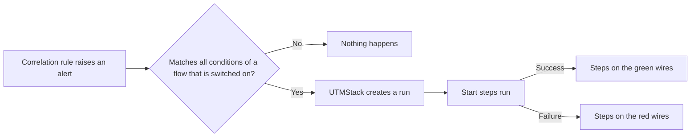

Automated response (SOAR, short for Security Orchestration, Automation and Response) lets UTMStack v12 act on an alert within seconds. You build **flows**: when a new alert matches a flow's conditions, the flow's steps run, for example a command on the affected machine through its UTMStack agent, a call to another system, an email, an in-app notification or a new incident.

## What a flow is

A flow has a name, a description, trigger conditions, and a set of steps linked by wires. You draw it on a canvas in **SOAR > Flows**.

| Concept | What it means |
|---|---|
| **Flow** | One automated response: trigger conditions plus the steps to run. |
| **Trigger conditions** | The alert fields a new alert must match. A flow runs only when **all** of its conditions match. |
| **Step** (the editor calls it a *node*) | One action: run a shell command, call a web address, ask the AI, send a notification, open an incident, send an email, or check a condition. |
| **Executor step** | A step that does something (for example runs a command). |
| **Enrichment step** | A step that fetches data that later steps can use (an HTTP call or an AI answer). |
| **Success wire / error wire** | Each step has two exits. The green wire runs when the step succeeds, the red wire when it fails. |
| **Start steps** | The steps wired directly from the trigger. They all start at the same time. |
| **Run** | One execution of a flow for one alert. Every step in a run gets its own row in **Execution history**. |
| **Agent** | The UTMStack agent on a machine. Shell steps run through it. |
| **Placeholder** | A value from the alert, written `$(alert.<field>)`, filled in when the step runs. |
| **Variable** | A stored value, written `$[variables.NAME]`, for example a token or a host name. Variables can be secret. |

## How a flow runs

1. A correlation rule raises a new alert.
2. The SOAR engine plugin checks the alert against every flow that the alert's tenant has switched on. Repeat alerts (echoes, which UTMStack groups under an earlier alert) never start a flow.
3. If all conditions of a flow match, the server creates a run and starts every start step.
4. When a step finishes, UTMStack follows its green wires if it succeeded, or its red wires if it failed. The branch that is not taken is recorded as **Unreachable**.
5. Each step and its status appear in **SOAR > Execution history**.

The server picks up new work as soon as it arrives and also checks for waiting steps every 15 seconds. It runs up to 5 steps at the same time, and one step may take up to 5 minutes. In testing of UTMStack v12.0.1, a command reached the machine about a quarter of a second after the alert.

## Where to find it

The **SOAR** menu has three pages:

| Page | What you do there |
|---|---|
| **Flows** | List, create, edit, copy, switch on and off, and start flows by hand. See **Flows Page** and **Building a Flow**. |
| **Execution history** | See every step that ran, its status and its target machine. See **Execution History and Run Statuses**. |
| **Interactive Console** | Run commands live on one agent. See **Interactive Console**. |

The old addresses `/soar/console` and `/soar/audit` still work: the first opens the Interactive Console, the second opens **Configure > Settings > App Audit Logs**.

## Who can do what

| Task | Permission | Built-in roles that have it |
|---|---|---|
| View flows, execution history and variables | `soar.read` | Administrator, Analyst, Viewer |
| Create, edit, delete, switch flows on and off, manage variables, use the Interactive Console | `soar.write` | Administrator, Analyst |
| Start a flow by hand (**Trigger flow**, the alert response button) | `soar.execute` | Administrator only |

Automated response does not need an Enterprise licence.

## Tenants

On a multi-tenant installation each tenant has its own flows, variables and history, and never sees another tenant's flows. The flows that ship with the product are shared, but each tenant switches them on separately. The instance operator (an Administrator of the default tenant) can also push a flow to many tenants at once with **Apply to all tenants**.

## What changed from UTMStack v11

- Workflows are now called **flows** and are drawn as a graph of steps, not a list of shell commands joined with `;`, `&&` and `||`.
- Steps are no longer only shell commands. There are HTTP call, AI enrichment, notification, incident, email and conditional steps.
- Placeholders start with `alert.`: `$(adversary.ip)` is now `$(alert.adversary.ip)`, and `$(log.message)` is now `$(alert.lastEvent.log.message)`.
- The catalogue of 73 action templates and the 23 playbooks are replaced by 94 shipped flows. Most of them have no trigger and are meant to be copied. See **Shipped Flows**.
- The **Automation Variables** page is gone. Manage variables from the **Variables** button in the shell step editor or in the Interactive Console.
- Statuses changed: see **Execution History and Run Statuses**.

## Before you switch a flow on

<Warning>

Flows act for real. They block addresses, disable accounts, stop processes, isolate machines and shut them down. Test every flow by hand with **Trigger flow** on a test machine before you switch it on.

</Warning>

- Every matching alert starts a new run. There is no limit and no grouping of runs, so a noisy rule can start the same flow many times.
- A flow you create **from scratch** is saved switched on and starts running at once. A copy of an existing flow is saved switched off. See **Flows Page**.
- Shell steps need the agent to accept remote commands. An agent installed with remote control disabled refuses every command, and this can only be changed by reinstalling the agent on that machine.
- To tell a failed command from a successful one, the agent must be from UTMStack v12.0.2 or later. Older agents report a failing command as executed, so the error wire never runs.

## Related pages

- **Flows Page**
- **Building a Flow**
- **Step Types**
- **Placeholders**
- **Step Outputs and Variables**
- **Shipped Flows**
- **Running Steps on Another Host**
- **Interactive Console**
- **Execution History and Run Statuses**
- **Use Cases**
- **Worked Examples: Responding Through Other Systems**
- **Troubleshooting Flows**
